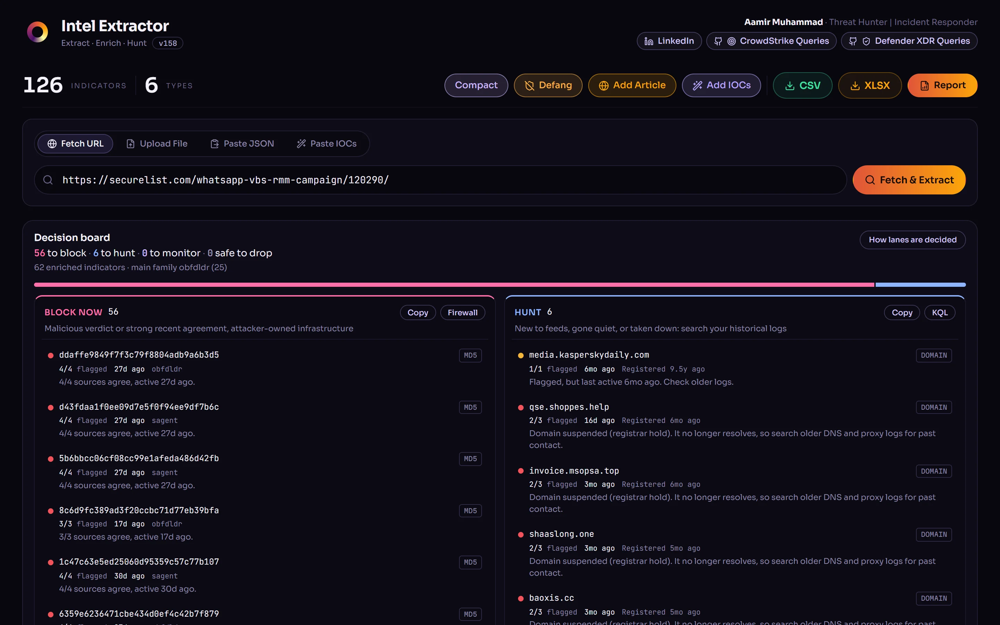
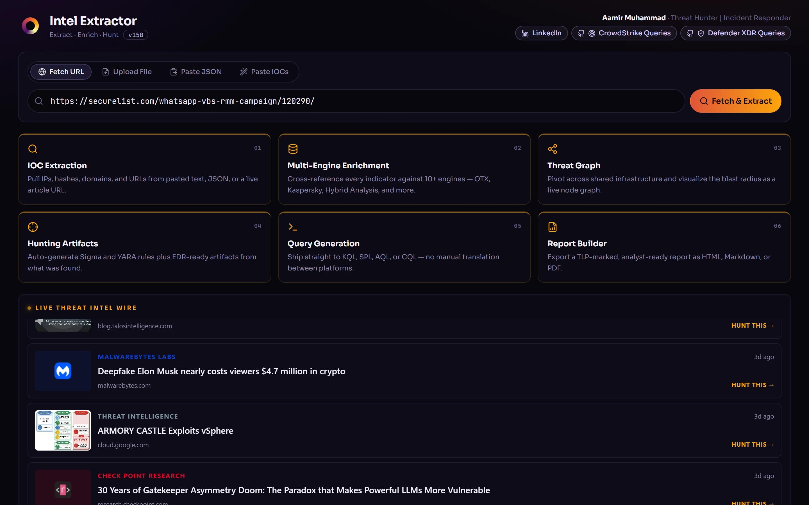
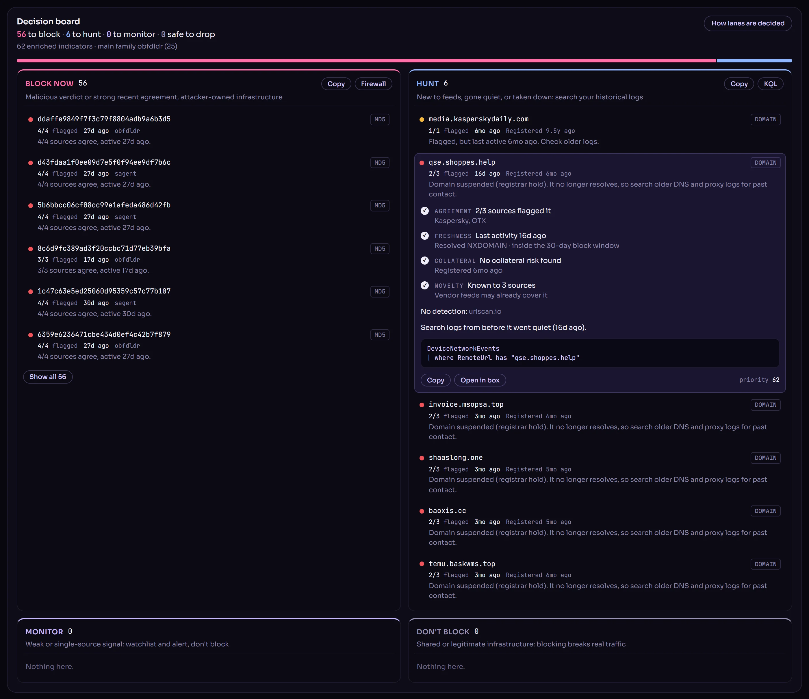
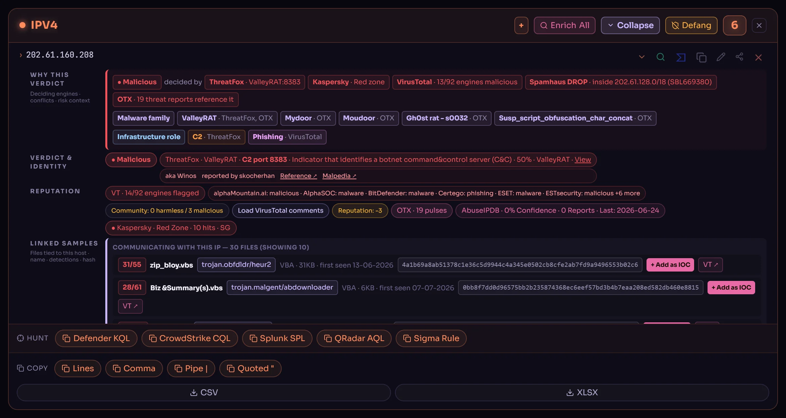
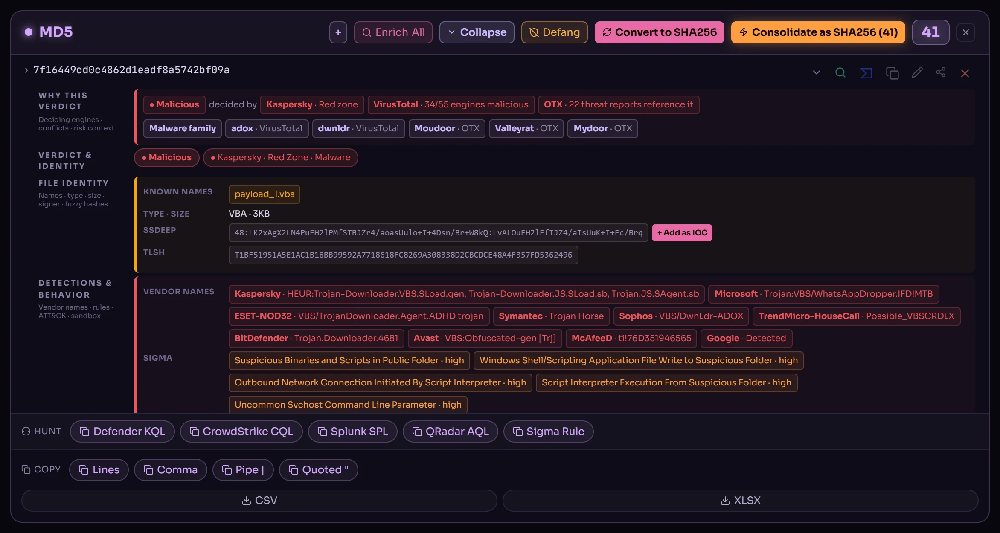
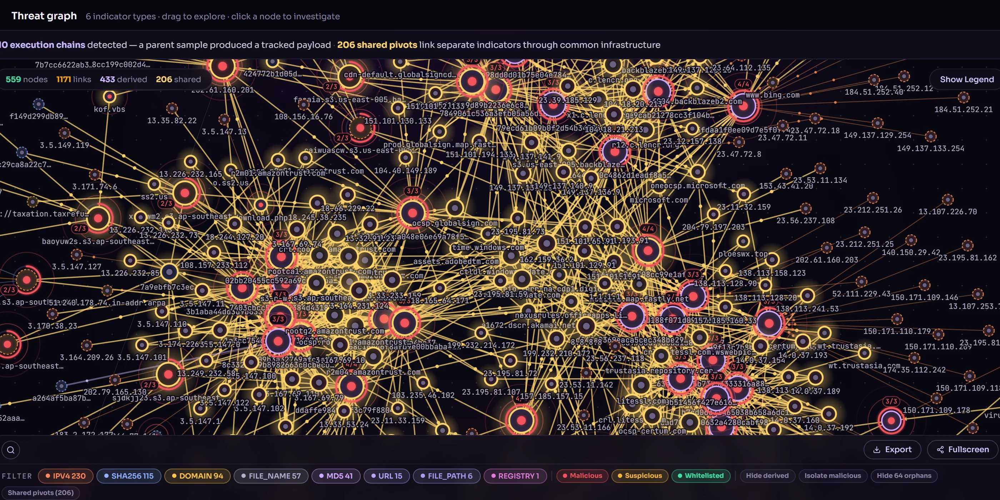
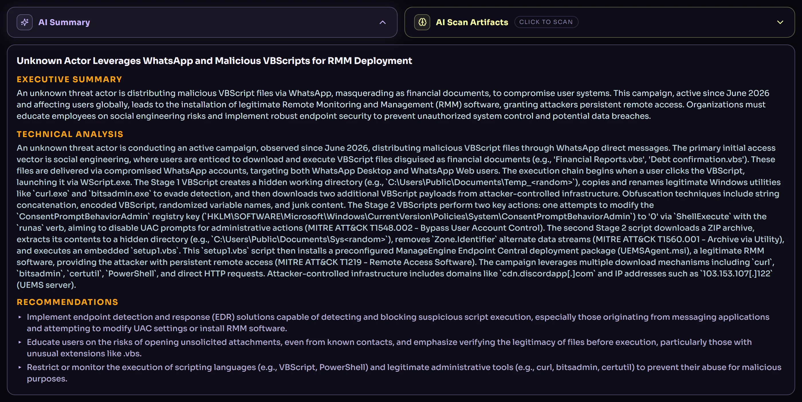
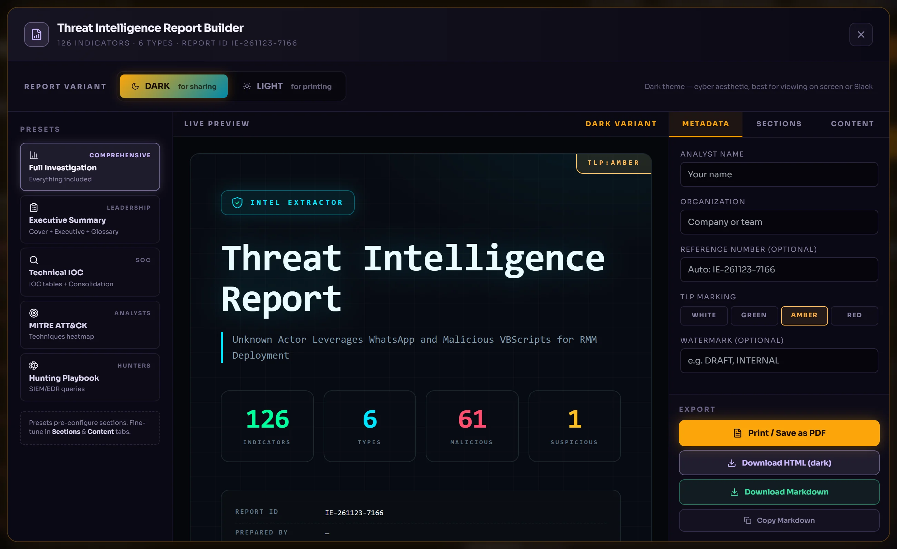

# Intel Extractor

**Paste a threat report. Get every indicator extracted, enriched, judged and ready to act on.**

### [ioc.threatterminal.com](https://ioc.threatterminal.com)

---

## 🧲 Extract from anything

Drop in a vendor report URL, a PDF, raw text or JSON. IPs, domains, URLs, hashes, emails, CVEs, ATT&CK IDs, file paths, registry keys, scheduled tasks, command lines and crypto wallets come out clean, refanged, de-duplicated and filtered of vendor noise. A live threat intel wire from the major research blogs is one click from a full extraction.

## 🎯 Decision Board

Every enriched indicator is sorted into one action lane: **Block now**, **Hunt**, **Monitor** or **Don't block**. Each row explains why: how many sources agree, how fresh the activity is, collateral risk and registry state. Expand a row and the ready-to-run hunt query is right there. Copy a whole lane as a firewall block list or a KQL hunt.

## 🔬 Verdicts you can defend

Indicators are checked against 20+ intelligence sources: ThreatFox, URLhaus, MalwareBazaar, VirusTotal, Kaspersky OpenTIP, AlienVault OTX, Hybrid Analysis, Tri.age, AbuseIPDB, Spamhaus DROP, SANS ISC, urlscan.io, PhishTank, Validin, CIRCL, WHOIS / RDAP, NVD, CISA KEV and EPSS.

**Why this verdict** names every engine that decided it. **Infrastructure role** says what a host is used for: C2, malware delivery, phishing or scanning. Linked samples, malware families and threat reports sit alongside.

Files get their full identity: known names, fuzzy hashes (ssdeep, TLSH), AV vendor names, Sigma hits and sandbox behaviour, with one-click consolidation of MD5 / SHA1 into SHA256.

## 🕸️ Threat Graph

A live pivot graph of everything the enrichment uncovered. It surfaces execution chains (a parent sample that dropped a tracked payload) and shared pivots, where separate indicators meet on common infrastructure. You can filter by type and verdict, isolate the malicious nodes, and click any node to investigate it.

## 🧠 AI Summary

One click turns the report into an executive summary, a technical analysis mapped to MITRE ATT&CK, and concrete recommendations. Every indicator in the output is defanged.

## 🏹 Hunt everywhere

Every indicator type ships with hunt queries for **Microsoft Defender / Sentinel (KQL)**, **CrowdStrike Falcon (CQL)**, **Splunk (SPL)**, **QRadar (AQL)** and **Sigma**, written with each platform's real field names. Copy lists as lines, comma, pipe or quoted, and export the results to CSV or XLSX.

## 📄 Report Builder

TLP-marked intelligence reports in one click:
- Presets: Full Investigation, Executive Summary, Technical IOC, MITRE ATT&CK and Hunting Playbook.
- Live preview, a dark variant for sharing and a light one for printing.
- Exports to PDF, HTML or Markdown.
- The report follows your filters and carries the Decision Board.

---

© Aamir Muhammad. Source-available under the PolyForm Noncommercial License 1.0.0 — commercial use and rehosting without permission prohibited.

